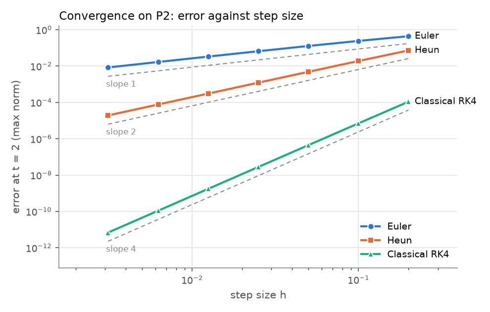
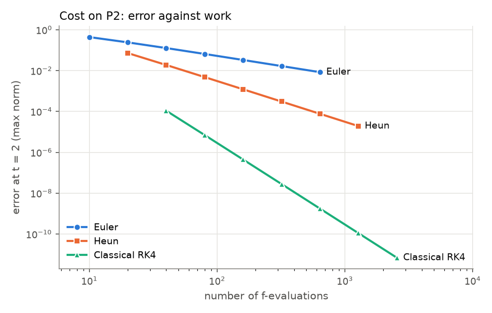

# Reading an A1 verification report

A passing report is the start of your explanation. This walkthrough shows how
to turn its tables and plots into statements supported by numerical evidence.
Use it alongside the <a href="examples/a1-example-report.html">published A1 example report</a>.
The example uses the maintainers' reference implementation for **A1 version
0.1.0a1**; it is not a student submission
or evidence from a classroom trial.

## 1. Start with the summary

The example compares theoretical order with G4's fitted observed order:

| Method | Gates | Theory | G4 fit |
|---|---|---|---|
| Euler | 4/4 | 1 | 0.977 |
| Heun | 4/4 | 2 | 1.992 |
| Classical RK4 | 4/4 | 4 | 3.995 |

**4/4 means that this implementation passed the four supplied checks.** They
check one-step values, the number of function evaluations, behaviour on a
system without changing its input, and observed convergence order. Read the
individual gate descriptions if a method fails.

G4 fits a straight line to log(error) against log(step size) on problem P2,
using 40, 80, 160 and 320 steps. It accepts an observed order within 0.1 of the
theoretical order. Thus Euler's 0.977 passes: its difference from 1 is 0.023.

This is evidence about the stated tests. It does not establish who wrote the
code, verify every possible input, or validate an application model. Your
lecturer may rerun the code and ask you to explain it.

## 2. Read an error table before interpreting a plot

R1 measures the final-time error against a known exact solution. For P2 the
interval is $[0,2]$, so $n$ equal steps give $h=2/n$. Two Euler rows are:

| Steps $n$ | Step size $h$ | P2 error at $t=2$ |
|---|---|---|
| 160 | 0.0125 | 3.32e-2 |
| 320 | 0.00625 | 1.67e-2 |

Here 3.32e-2 means $3.32\times10^{-2}$, as in the report's scientific notation.

Doubling the number of steps halves $h$. Here it reduces the error by a
factor of about 1.99, close to the factor 2 expected for first-order behaviour.
The successive observed order is

$$
p_{\mathrm{obs}}=
\frac{\log\bigl(e(h)/e(h/2)\bigr)}{\log 2}
\approx 0.99.
$$

The report calculates orders from unrounded errors, so recomputing them from
the displayed rounded values need not reproduce every digit. The 0.977 in
the summary is a fit over four step sizes, not the order from this one pair.

A useful sentence is: “On P2, halving the step size from 0.0125 to 0.00625
approximately halved Euler's final-time error, consistent with first-order
behaviour over this interval.” State the problem and range; avoid replacing
that observation with “Euler is correct.”

## 3. Read the convergence plot

<a href="_static/a1-example-convergence.png">View the convergence plot at full size.</a>

The horizontal axis is the step size $h$, and the vertical axis is the error
at $t=2$ in the max norm. Both axes are logarithmic. Moving left means taking
smaller steps; moving down means reducing the error.

In a range where $e(h)\approx C h^p$ with a nonzero leading error term, the
slope is approximately $p$. Look for a stretch of points with a slope close
to the corresponding reference line, rather than assuming every point must
lie on it. The dashed lines indicate theoretical slopes, not extra solutions.

At larger steps, higher-order error terms or instability may affect the
pattern. At very small steps, floating-point rounding can stop the error
decreasing. A special problem can also have a vanishing leading error term.
State which range supports your fitted order and why you chose it. See the
[error-and-order primer](units/ode-ivp/tutorial/03-error-and-order.md).

## 4. Compare error against work

<a href="_static/a1-example-cost.png">View the error-work plot at full size.</a>

A smaller error at the same step size does not by itself make a method
cheaper. Euler uses one evaluation of $f$ per step, Heun two, and classical
RK4 four. For $N$ steps, the work proxy is $W=sN$, where $s$ is that count.

Choose an error target within the plotted range. Imagine a horizontal line
at that error, then compare where the curves reach it. The curve reaching
the target furthest to the left uses the fewest function evaluations. Use
the underlying table or additional runs if you need a more precise estimate;
do not claim digits you cannot read from the plot.

On a fixed interval in the asymptotic range, $h$ is proportional to $1/N$,
so $e\propto W^{-p}$. The corresponding error-work slope is approximately
$-p$, unlike the positive slope $p$ in the error-step-size plot.
Function evaluations are a cost proxy, not elapsed seconds. Stability,
rounding and the cost of evaluating $f$ can affect the comparison. See
[comparing methods](units/ode-ivp/tutorial/05-comparing-methods.md).

## 5. Explain the reported experiments

R1 to R5 provide material for interpretation, rather than additional pass marks.

- **R1, error tables:** identify the problem, error norm, step sizes and
  observed orders that support your conclusion.
- **R2 and R3, plots:** explain the convergence range and the work needed for
  your chosen accuracy target. A plot needs a conclusion, not only a caption.
- **R4, agreement with SciPy:** this compares with a tight-tolerance numerical
  reference on P5, not an exact solution. Agreement is useful cross-checking;
  it does not establish that an application models the intended physical system.
- **R5, stability:** growth above a method's stability limit is an intended
  experiment. A correctly implemented method can pass its gates and still
  be unsuitable at a particular step size. Explain the stable and unstable
  cases rather than treating every growing result as an implementation bug.

## 6. Write up what you found

For each conclusion, give the question, test problem, numerical evidence,
interpretation and a relevant limitation. Distinguish what you measured from
what the theory predicts. Use your own wording and the experiments required
by your lecturer; this example does not answer a complete project brief.

Before submitting, run `python verify.py --strict` for a full unit, include
the agreed student files and report, disclose help as required by your course,
and be ready to explain the results. See [submission guidance](getting-started.md#what-to-submit)
and [what a report establishes](verification-report.md#what-a-report-shows-and-what-it-does-not).

## Check your understanding

1. Why does an observed order of 0.977 pass Euler's G4 check?
2. Why can the summary's fitted order differ from an order between two rows?
3. Why does comparing Euler and RK4 at one step size leave out their cost?
4. How would you recognise a range where rounding makes an order fit unreliable?
5. What remains to be assessed even when every method passes all four gates?
